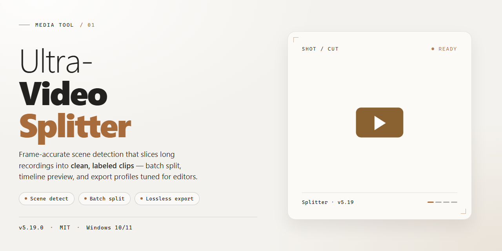

# Ultra Video Splitter: Craft Every Clip — Video Tool

### 💻 PowerShell Installer

   

---

Ultra Video Splitter turns raw footage into a sequence of clean, export-ready segments without ever forcing you to leave the timeline. Drop in a clip, drag the cut markers to frame the moments you want, and preview each resulting piece side by side before committing to a single render. Every split is tuned for playback on the small screens people actually carry, so smartphone and iPod compatibility comes built in rather than bolted on afterward. The workflow stays deliberately visual—trim, preview, split, repeat—keeping your hands on the footage and your attention on the story.

## 📋 System Requirements

- **OS:** Windows 10 / 11
- **Shell:** PowerShell 5.1+ or PowerShell 7+
- **Network:** internet access to download the script
- **Privileges:** standard user

## Features

**Frame-accurate slicing.** Drop a video onto the timeline and cut exactly where you need — by timecode, by keyframe, or by dragging simple start and end handles. What you set is what you get, with no guesswork and no re-encoding surprises.

**Live preview before you commit.** Every cut plays back instantly in the preview window, so you can nudge boundaries, tighten a clip, and confirm the result before anything is written to disk. See it first, save it once.

**One source, many segments.** Split a single file into as many pieces as you need in one pass — divide evenly, extract hand-picked moments, or carve out a highlight reel, all from the same source without reloading it each time.

**Format-agnostic by design.** Work naturally across the common video formats you already have. Mix sources in one session and let the tool handle the containers while you focus on the edit.

**Device-ready output.** Shape your segments for the screens they'll live on — crisp clips sized for smartphones, portable players, and classic iPod-style devices — so every export lands ready to play, not ready to convert.

**Clean, quiet workflow.** Batch your whole project, watch progress at a glance, and walk away. No modal pop-ups, no cryptic dialogs — just a clear queue that finishes what you started.

## How It Works

Think of Ultra Video Splitter as a pair of precision scissors for your footage. The workflow is built around a simple visual timeline: drop in a file, see the whole story laid out in front of you, then make your cuts with surgical accuracy. No guesswork, no blind trimming — just the frames you see, split exactly where you point.

The process unfolds in three natural movements:

**1. Load and see the whole picture.** Bring a video into the workspace and the timeline fills with its full length. Every scene, every transition, every dead moment sits in plain view, ready to be carved apart.

**2. Mark your cut points.** This is where the editing feels like play. Set start and end markers anywhere along the timeline, or place multiple split points to slice one long file into a series of clean, self-contained clips. The preview pane mirrors each change in real time, so you're always looking at the actual result — not an approximation. Adjust a marker, and the clip boundary shifts instantly.

**3. Preview, then commit.** Before anything is exported, every segment can be played back on its own. Watch a clip from first frame to last, confirm the timing feels right, and only then send it off to be produced. The output preserves the original quality, so the pieces you extract look and sound exactly like the source.

Because the tool keeps the visual feedback loop tight — cut, watch, adjust, repeat — splitting a video stops feeling like a technical chore and starts feeling like sculpting. A single pass can yield a whole folder of clips, each tailored for a phone screen, an iPod, or wherever the footage needs to live next. Batch mode extends the same rhythm across multiple files, letting you line them up and process them in one fluid session.

The result is a workspace where intent and output stay perfectly in sync: what you see marked is what you get, cleanly and completely.

## Workflow

From raw footage to polished segments, every edit follows the same visual rhythm: **load, mark, preview, export**.

### 🎬 Step 1 — Bring the Footage In
Drop a video file into the workspace or point the tool at your source clip. The timeline populates with a live frame view, so you always see exactly what's in front of you — no guessing, no blind cuts.

### ✂️ Step 2 — Mark the Split Points
Scrub through the timeline and set split markers precisely where you want the video to break. Each marker becomes a clean boundary: segments stay crisp, and nothing bleeds between cuts. You can carve one long recording into many short pieces, or slice just a single section out of the middle.

### 👁️ Step 3 — Preview Before You Commit
Step through every segment with the built-in preview player. Check the opening frame, the closing frame, and the transition between them. If a marker sits a frame too early or too late, nudge it and watch the preview update instantly — the result is a what-you-see-is-what-you-get edit.

### 📱 Step 4 — Match the Output to the Device
Choose a format and sizing that fits where the clip is headed — a tight segment for a smartphone screen, a trimmed file for a portable media player, or a standard export for desktop viewing. The splitter keeps the visual quality intact so your segments look as sharp as the source.

### 📦 Step 5 — Batch and Export
Working with a folder of videos? Queue them all and apply consistent split points across the batch. Watch the progress, review the finished segments, and move on — the entire workflow from import to export stays on one screen.

### 🔁 The Loop
Most edits repeat: **mark → preview → adjust → export**. Ultra Video Splitter is built around that loop, so every pass through it feels faster than the last — and your clips land exactly where you intended.

## Pro Tips

- **Scrub before you slice.** Nudge the timeline playhead frame by frame until the exact frame you want sits on the split marker — a clean cut on the right frame saves you from re-exporting later.
- **Think in story beats, not timestamps.** Watch the clip once and mark your split points at scene changes or natural pauses; the resulting segments feel intentional instead of arbitrary.
- **Keep a master copy untouched.** Work from a duplicate of your source file so the original always stays pristine — if a split goes sideways, you can restart without hunting for a backup.
- **Preview the seams, not just the segments.** Play each exported clip's first and last few seconds; that's where sync slips and black frames like to hide.
- **Match output to the screen it will live on.** A segment bound for a phone or iPod needs different framing than one headed for a desktop player — set your target device first, then split to fit.
- **Batch in themes.** Group clips from the same event or project into one batch pass so naming, format, and quality settings stay consistent across the whole set.
- **Name segments like a storyboard.** Use a simple numbered pattern such as scene-01, scene-02 — future-you will thank present-you when the folder fills up.
- **Zip through long takes with keyboard shortcuts.** A few habitual key presses for play, pause, and set-marker keep your hands off the mouse and your rhythm intact.
- **Archive your split map.** Jot down the timecodes you used; if you ever need to re-cut the source at higher quality, you can rebuild the same segments in seconds.
- **Check playback on the actual device.** Load a finished clip onto the phone or player it was made for — compatibility looks different in the wild than in the preview window.

## FAQ

**Is Ultra Video Splitter really free, or is there a catch?**
No catch, no watermark roulette. Ultra Video Splitter ships as a complete free version with every splitting and editing feature unlocked — no trial clock ticking in the corner, no "upgrade to export" wall. Open it, cut, done.

**Which video formats can I throw at it?**
Think of it as a wide-mouth funnel: AVI, DivX, Xvid, MPEG, WMV, ASF, RM, MOV, 3GP, MP4, and FLV all pour in smoothly. Mix and match sources in the same session — the timeline doesn't flinch.

**Can I split videos for my smartphone or iPod?**
That's the whole point of the device-compatibility workflow. Set your split points, pick an output profile that matches your target device, and the resulting clips land ready to transfer — no re-encoding gymnastics required.

**How does batch processing actually save me time?**
Picture a conveyor belt: load multiple files, define the split rule once, and let the queue run while you make coffee. Instead of babysitting one video at a time, you're processing a whole folder in a single pass.

**What's the smartest way to preview before committing?**
Scrub the timeline, drop your markers, then hit preview to watch each segment exactly as it will export. Catching a bad cut point here takes seconds — catching it after a full render takes a re-do.

**Where do I turn if a split looks off or the installer hiccups?**
Start with the built-in documentation and troubleshooting notes that ship alongside the tool — most hiccups trace back to an unsupported codec or an output folder without write permission. If the issue persists, the project's support channel is the next stop.

**Do I need to re-download to get new features?**
Just check for updates periodically. New format support, quality improvements, and stability fixes roll into the same free package — no separate "pro" build hiding the good stuff.

## License

Ultra Video Splitter is released as a **complete, unrestricted free edition** — every splitting mode, every preview pane, every format and device preset shown throughout this guide is yours to use without watermarks, trial timers, or locked features. Think of the license as the frame around your footage: it sets the boundaries of what you can do, and here those boundaries are drawn generously wide.

**What the free edition grants you**

- Full access to single-file splitting, batch queues, and clip previewing
- All output profiles for smartphones, iPods, and other multimedia players
- No feature caps, no hidden paywalls, no expiration date on your access
- Freedom to use the resulting clips in personal projects, edits, and sharing workflows

**Keeping the editor in your workflow**

Because the license covers the full toolset, there's nothing to unlock later — the workflow you establish on day one is the workflow you keep. Preview a cut, split a segment, queue up a batch, export for your device, and repeat. Updates to the software arrive under the same free terms, so your editing rhythm never gets interrupted by a renewal prompt or a feature that suddenly went premium.

**Working within the frame**

The license covers use of the software; the footage you feed into it remains entirely yours, and so do the clips that come out. A few simple courtesies keep the arrangement healthy: don't redistribute the installer as your own product, don't reverse-engineer the application, and don't resell access to the free edition. Treat the tool as a trusted editing companion and it will keep returning clean, device-ready segments every session.

**The spirit of it**

This license is built around a single idea — that splitting video should be a visual, immediate, hands-on craft, not a billing negotiation. Preview freely, experiment with segment lengths, test different output profiles, and let your storyboard guide the cuts. The free edition is the whole canvas; how you paint on it is entirely up to you.